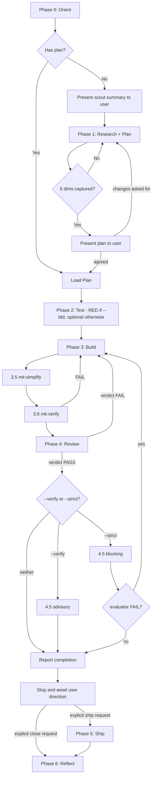

# Workflow Steps — 7-Phase Pipeline

Per-phase instructions for `mk:cook`. The sequence and transitions are owned by `.claude/skills/workflow-orchestrator/workflow.yaml`; this page says what each phase must achieve and how to know it did.

## Contents

- [Phase 0: Orient](#phase-0-orient)
- [Phase 1: Research + Plan](#phase-1-research--plan-skip-if-code-mode)
- [Phase 2: Test](#phase-2-test)
- [Phase 3: Build](#phase-3-build)
- [Phase 3.5: Simplify](#phase-35-simplify)
- [Phase 3.6: Verify](#phase-36-verify)
- [Phase 4: Review](#phase-4-review)
- [Phase 4.5: Verify (browser or evaluator)](#phase-45-verify-browser-or-evaluator--only-with---verify-or---strict)
- [Phase 5: Ship](#phase-5-ship-explicit-request-only)
- [Phase 6: Reflect](#phase-6-reflect-explicit-close-request)
- [Workflow Evidence Index](#workflow-evidence-index-traceability-only)
- [Lifecycle Diagram](#lifecycle-diagram)

Task tracking: where a tracked-task tool is unavailable (some GUI editor extensions), use a plain to-do list. Plan files stay the source of truth.

## Phase 0: Orient

Goal: know the mode, the tier and the codebase context before planning.

1. Read `phase-contracts.md` once per run.
2. Detect the mode (`intent-detection.md`).
3. Declare the tier as `Task complexity: [TRIVIAL|STANDARD|COMPLEX] → [model]`. Auth, payments and security are always COMPLEX; a feature under 5 files is STANDARD; a rename, typo or format is TRIVIAL.
4. For a plan path: load it and parse the phases. If plan.md has an `## Autonomy Boundaries` block, read it once and follow it by mode: interactive runs ask on an "Ask first" item when it arises; auto runs defer it (skip the action, log the decision in the plan.md Agent State, take the safe default) because a blocking prompt mid-autonomous-run stalls the run. With no block, proceed on reversible in-scope changes. The block never relaxes a security rule.
5. Create one tracked task per phase when the host supports it.

## Phase 1: Research + Plan (skip if code mode)

Goal: a plan the user has agreed, with acceptance criteria a check can settle.

- **Interactive / auto:** `researcher` agents in parallel for external knowledge when the task needs it, `mk:scout` for the codebase, then `mk:plan-creator` writes `tasks/plans/YYMMDD-name/plan.md` and `phase-XX-*.md`.
- **Fast:** skip research; `mk:scout` then `mk:plan-creator --fast`. For a non-trivial task the plan is still required.
- **Parallel:** `mk:plan-creator --parallel` adds the dependency graph and file-ownership matrix.

Flags to pass to `mk:plan-creator`: `--fast`, `--hard` (stricter criteria), `--deep` (higher-fidelity phase breakdown; consider it when the task touches 5+ directories or is refactor + complex), `--parallel`, `--two` (product and engineering lenses), `--product-level`. Pass `--tdd` through so the plan carries TDD-aware criteria.

### Agree the plan (non-auto mode)

Run `mewkit plan check <phase-file>` on the plan (add `--structural` for the whole plan). It reports missing required sections; a failing check means the plan is unfinished, so fill the gaps before building. Nothing blocks the edit either way: the check is information.

Then present the plan summary and ask the user (header "Plan"): looks right, revise, or abort. In auto mode there is no pause: write the plan, run the check, route a failure back to `mk:plan-creator`, and put the plan and the check result in the run summary.

## Phase 2: Test

Goal: tests that describe the criteria before the code exists, when `--tdd` / `MEOWKIT_TDD=1` is on; otherwise optional.

- `--tdd` (all modes except no-test): delegate to `tester` via `mk:testing` to write tests from the plan's acceptance criteria. They must run and fail; a compile or syntax error is not a failing test. If they pass already, they do not describe the change: rewrite them. Rules: `tdd-rules.md`.
- `--fast`: tests cover plan intent only; say "coverage may be lower" in the summary.
- `--no-test`: skip the phase (invalid together with `--tdd`).

Non-auto runs pause after the RED tests: show the test list and ask to proceed, adjust or abort.

## Phase 3: Build

Goal: the plan's phase implemented, type-checked, with its tests passing.

Before spawning any subagent read `orchestration-rules.md`; in parallel mode also `parallel-execution-rules.md`.

**Premise check.** On the standard path, when the plan carries open `[ASSUMPTION]` items, delegate one read-only `researcher` run before the first edit to check each against the code. It returns `holds` or `false` per item with `file:line`; an item it cannot check is reported unchecked, and a finding without `file:line` is dropped. A `false` assumption goes back to the plan before building. Skip it in quick runs and when no assumption is open.

**TDD pre-check.** TDD mode is on when `MEOWKIT_TDD=1` is set or `.meowkit/state/tdd-mode` contains `on`. Then confirm at phase start that the Phase 2 tests exist and fail. This is a phase-start check, not a per-write one.

Build steps:

1. List tasks already hydrated by the planner and pick them up; create one per plan phase if none exist. Mark each `in_progress` when you start it.
2. Execute sequentially, or per file-ownership group in parallel mode (distinct files, no overlap, wait for the group).
3. Type-check after each file you modify.
4. If tests fail, self-heal up to 3 attempts, each a different approach. After 3, delegate root-cause analysis to `researcher` via `mk:investigate`, fix, and retry. After 3 more failures stop and escalate to the user with the failing output, the attempts and the suspected cause.

## Phase 3.5: Simplify

Goal: the green code is as simple as it can be with the same behaviour, before anyone reviews it. Run `mk:simplify` through the `developer`; the tests must still pass afterwards. Simplify once, review once: it avoids review-fix-simplify cycles.

Non-auto runs show the implementation summary and ask to proceed to review, request changes, or abort.

## Phase 3.6: Verify

Goal: a clean build, lint, type-check, test and coverage signal on the simplified code. Run `mk:verify` (scoped to changed files by default; `--full` for a whole-project sweep). On failure return to Build, fix, and re-run before Phase 4. Record the commands and the overall result for the evidence index.

## Phase 4: Review

Goal: a verdict file the user can rely on, written by an agent that did not write the code.

If the plan directory holds `red-team-findings.md`, pass its contents to the reviewer so it can check which findings the code addressed.

Delegate to `reviewer` (brief shape in `subagent-patterns.md`) to review against the plan's acceptance criteria and the contracts the task touches, covering security, performance and YAGNI/KISS/DRY. The reviewer writes `tasks/reviews/YYMMDD-name-verdict.md`. Read it before any ship request: a FAIL dimension or a security BLOCK is a reason to go back to Build. No hook checks this; the reading is the control.

Present the verdict and ask (header "Review"): with critical issues, fix critical / fix all / ship as is / abort; without, continue / fix warnings / abort. Auto mode does not pause: it fixes what it can and puts the verdict path in the run summary. The cycle cap and regression handling are in `review-cycle.md`.

A trivial change (see `SKILL.md`, Profiles) skips this phase.

## Phase 4.5: Verify (browser or evaluator) — only with `--verify` or `--strict`

### `--verify` [LIGHT]

Advisory: the run continues either way and the user decides.

1. If the diff has no UI files (`.vue .tsx .jsx .html .css .scss .svelte .astro`), note it and skip.
2. Boot the dev server if it is not running (`dev` or `start` script; fall back to a request on localhost:3000). If nothing runs, note it and skip.
3. Check the root page (cap 3 pages): it has content, no framework error overlay, no console errors. Take a screenshot when a browser skill is available.
4. PASS if pages load with content; FAIL on a blank page, an overlay or console errors. Report findings; stop the dev server you started.

### `--strict` [HEAVY]

Fires on `--strict`, or when `mk:scale-routing` returned `level=high` at Phase 0 (say which). Supersedes `--verify`. Read `harness-rules.md` first.

Delegate to `evaluator` to run `/mk:evaluate` on the build: target is the project root, rubric preset auto-detected from `package.json`, with the changed files and the review and test outcomes as context; it returns PASS, WARN or FAIL plus the verdict path. PASS: report completion. WARN: the user decides. FAIL: do not report completion; route back to Build with the evaluator feedback, at most 2 evaluator iterations.

## Phase 5: Ship (explicit request only)

After the review verdict, stop. A PASS is not a request to ship. When the user asks, delegate to `shipper` with `mk:ship`: pre-ship checks, a conventional commit, a PR when on a feature branch, CI, and rollback notes. Cook never spawns `git-manager` directly; shipper does.

## Phase 6: Reflect (explicit close request)

Run it after shipping or when the user asks to close the run without shipping.

1. **Plan sync.** Tick the completed todos, run `mewkit plan sync <plan-dir>`. When it prints `plan complete`, run `mewkit plan archive <plan-dir>` (it stamps `status: completed` and moves the plan to `tasks/plans/archive/`). Unmatched todos are reported by the command; fix them. If the binary lacks `plan sync`, apply the Sync-Back Algorithm in `.claude/skills/plan-creator/references/task-management.md` by hand.
2. **Docs.** State `Docs impact: none|minor|major` and update `docs/` accordingly. Large changes: delegate to `documenter`.
3. **Memory.** Append one gotcha or decision with `mewkit note` only when it is not derivable from the code; usually nothing.
4. Mark session tasks complete.

### Per-phase checkpoint (after each completed plan phase, before the next one)

A fresh session after a context reset can resume only if the durable surfaces are current. After each completed plan phase: flip its `[ ]` items to `[x]`, run `mewkit plan sync <plan-dir>` (rewrites phase status, the plan.md table and `.plan-state.json` from the checkboxes), and update the plan.md Agent State block. `.plan-state.json` is derived; a hand edit drifts from the checkboxes, which are the authority. Re-running on an unchanged phase makes no change.

Auto mode, after an explicit close request: loop to Phase 2 while plan phases remain. Other modes: ask the user before the next phase.

## Workflow Evidence Index (traceability only)

Contract: `.claude/skills/advise/references/workflow-evidence-rules.md`. Fill one `tasks/plans/<plan>/reports/evidence/workflow-evidence.json` from outputs that already exist; it adds no agent work, carries no score and decides nothing. Store pointers and summaries, not raw logs; scrub secrets and PII.

| Phase | Evidence fields |
|---|---|
| 0 Orient | `mode`, tier, `risk.matchedFlags` (see `.claude/skills/agent-detector/references/risk-checklist.md`) |
| 1 Plan | `planPath`, `cookContract` (the five requirements; skip for a plan-path input), plan check result |
| 3 Build, 3.5 Simplify | changed-files summary, simplify status |
| 3.6 Verify | `verification.commands`, `verification.overall` |
| 4 Review | `review.verdictPath`, `review.status`, `review.sideEffectsDetected` |
| 4.5 | `--verify` / `--strict` result only |
| 5, 6 | ship pre-flight status; sync-back and docs-impact status |

`evidenceRevision` binds Verify and review output to the source state they saw; `scopeRevision` records when the plan last changed. A returned correction advances the revision and marks `verification` and `review` superseded (`mewkit advice commit … --evidence <path>` does it). A superseded record describes code that no longer exists: re-run the checks and record fresh output. Absent revision fields mean revision 1 with nothing superseded.

## Lifecycle Diagram

A convenience render; `.claude/skills/workflow-orchestrator/workflow.yaml` is the authority.

Stop after reporting completion: Phase 5 and Phase 6 never start on their own. Done means what `SKILL.md` lists under "Done means"; once Phase 6 begins, finish its steps before reporting it complete.
