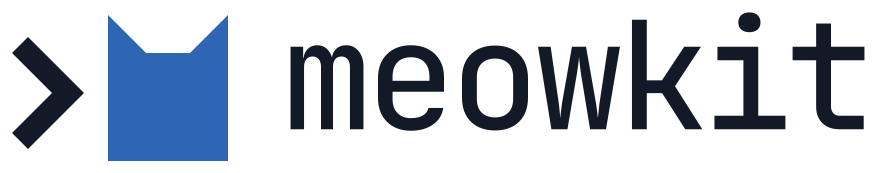

<p align="center">
  <picture>
    <source media="(prefers-color-scheme: dark)" srcset="assets/branding/meow-logo-dark.svg" />
    
  </picture>
</p>

<h1 align="center">MeowKit</h1>

<p align="center">
  <strong>AI agent toolkit for Claude Code</strong><br>
  128 skills &middot; 42 agents &middot; 7 rules &middot; 27 hook scripts &middot; 4-layer+ security
</p>

<p align="center">
  <a href="https://meowkit.dev"></a>
  <a href="https://docs.meowkit.dev/"></a>
  <a href="https://github.com/ngocsangyem/MeowKit/releases"></a>
  <a href="LICENSE"></a>
</p>

---

> [!IMPORTANT]
> **The Node/npm `mewkit` CLI is no longer maintained.** Its last release is `mewkit@2.3.1`, and
> `npx mewkit` gets no new fixes or kit support. Use the native `mewkit` binary instead (short
> alias: `mk`). Install it as shown in [Install the CLI](#install-the-cli); moving over is covered
> in [Moving from `npx mewkit`](#moving-from-npx-mewkit) and the
> [installation guide](https://docs.meowkit.dev/installation).

## What is MeowKit

MeowKit installs a `.claude/` directory that Claude Code reads at session start. It enforces a structured 7-phase workflow with hard gates, TDD, security scanning, and a two-file team memory store (`.meowkit/memory/decisions.md`, `gotchas.md`) read by grep. Zero external dependencies for core workflow.

**Homepage:** [meowkit.dev](https://meowkit.dev) &nbsp;·&nbsp; **Docs:** [docs.meowkit.dev](https://docs.meowkit.dev/)

## Quick Start

### Install the CLI

macOS and Linux:

```bash
curl -fsSL https://raw.githubusercontent.com/ngocsangyem/MeowKit/main/install.sh | sh
```

Windows (PowerShell):

```powershell
irm https://raw.githubusercontent.com/ngocsangyem/MeowKit/main/install.ps1 | iex
```

The installer checks the archive's size and SHA-256 against the pins it carries, then puts
`mewkit` on your PATH with `mk` beside it. `mk` is the same binary under a shorter name, so
`mk doctor` and `mewkit doctor` do the same thing. Later updates come from `mewkit self-update`.

### Add MeowKit to a project

MeowKit installs two ways. Pick **one** per project — running both resolves the
same skills and agents twice (`mewkit doctor` warns when it detects both).

### Flat-copy (default, supported)

```bash
mewkit init
```

The CLI fetches the latest release from GitHub, prompts for config, and scaffolds `.claude/` and `.meowkit/` into your project — the only two directories it adds. Skills resolve as `/mk:*`, agents as `mk:*`.

### Native plugin (recommended on Claude Code; experimental on Codex)

Installs the `mk` plugin from the MeowKit marketplace. Skills (`/mk:*`), agents (`mk:*`), and hooks all resolve under the plugin; nothing is copied into your project.

> **Codex support is an experimental projection.** MeowKit is fully enforced on Claude Code (real hooks gate behavior); on Codex the capability projection is advisory — hook enforcement is version-gated and not statically guaranteed, so gates deter but do not block. Run `mewkit providers codex --lifecycle` to see exactly what is enforced vs advisory.
>
> **Codex and Cursor get an authored bundle, not a conversion.** `mewkit init --target codex|cursor` copies a hand-maintained native bundle shipped in the kit; nothing is converted from `.claude/` at install time. The bundles are checked structurally (artifact set, denied tokens, install idempotency) in CI. That is evidence of structural parity, not of identical behavior across hosts.
>
> **Validate a generated Codex project** with `mewkit validate --target codex <dir>` — a read-only post-install gate that checks the config/hook wiring, that hook wrappers exist + are executable + carry the deny contract, that agent TOMLs parse, and that installed skills declare a supported runtime and carry no host-bound tool tokens. `mewkit doctor --providers` run inside a Codex project recognizes it and points at this command.

```bash
mewkit init --target claude-code --delivery plugin
```

The plugin shape is produced by the install itself, which is why there is nothing to build ahead of
time: the same emitter writes the kit's skills, agents and hooks for both deliveries, and
`--delivery plugin` adds the `.claude-plugin/plugin.json` manifest the host reads. There is no
`build-plugin` verb, no committed `plugin/` payload, and no marketplace publication — MeowKit is not
published to a plugin marketplace, so `claude plugin marketplace add` and its Codex equivalent have
nothing to resolve. Run `mewkit providers claude-plugin --lifecycle` to see what the plugin delivery
enforces.

### Setup (required for Python skills)

After installing MeowKit, run:

```bash
mewkit setup
```

This writes `.mcp.json` and `.meowkit/.env`, extends `.gitignore`, seeds
`docs/project-context.md`, and prepares the per-skill Python environments under
`.meowkit/envs/<skill>/` — one environment per skill, created on demand rather
than one shared venv. `--system-deps` interactively prompts for optional system
deps (ImageMagick, FFmpeg, Playwright browsers).

Run once per project. Idempotent — safe to re-run after upgrades.

To verify your environment after setup:

```bash
mewkit doctor     # Verify environment
```

## Moving from `npx mewkit`

1. Install the binary as shown in [Install the CLI](#install-the-cli).
2. Remove the npm package wherever you installed it: `npm uninstall -g mewkit`, or drop
   `mewkit` from a project's `devDependencies`.
3. Run `mewkit doctor` in each project. The kit already in `.claude/` and `.meowkit/` keeps
   working; `mewkit upgrade` takes it forward from here.

Hooks look for the binary on your PATH first. A project that still has the npm CLI in
`node_modules/.bin` keeps running it until you remove it.

## Requirements

- The `mewkit` binary (see [Install the CLI](#install-the-cli))
- Node.js 24+ (the kit's hooks run on Node)
- Python 3.9+ (optional — only for the skills that run Python; the core workflow needs none)
- Git

## Project Structure

```
meowkit/
├── .claude/                  Source of truth — agents, skills, rules, hooks
│   ├── agents/               42 specialist agents
│   ├── skills/               128 skills (mk: namespace) — 127 ship; benchmark is maintainer-only
│   ├── rules/                7 enforcement rules (always-on)
│   ├── hooks/                27 hook scripts — lifecycle hooks + handlers — plus their libraries
│   ├── statusline.cjs
│   └── settings.json
├── .meowkit/memory/          Team store: decisions.md + gotchas.md (committed)
├── crates/                   The mewkit CLI (Rust)
├── kit/bundles/              Authored Codex and Cursor bundles
├── packages/
│   └── landing/              Landing page (meowkit.dev, Nuxt + Tailwind v4)
├── scripts/                  Release automation
├── packages/docs/            Fumadocs documentation
├── CLAUDE.md                 Maintainer guide for this repo (not shipped to projects)
├── .releaserc.cjs            Semantic release config
└── .github/workflows/        CI/CD (release, beta, PR validation)
```

## Releasing

See **[RELEASING.md](RELEASING.md)** for the complete release guide — manual steps, CI/CD automation, troubleshooting.

## Development

```bash
cargo build -p mewkit-cli          # Build the CLI (target/debug/mewkit)
cargo test --workspace             # CLI tests
pnpm install                       # Dependencies for the hook, script and docs tests
npm test                           # Hook, script and kit tests
npm run lint                       # Lint
```

## License

MIT

## Inspiration

- [gstack](https://github.com/garrytan/gstack) — Skills, review patterns, ship workflow
- [antigravity-kit](https://github.com/vudovn/antigravity-kit) — Clean code standards, vulnerability scanning
- [aura-frog](https://github.com/nguyenthienthanh/aura-frog) — Agent detection, workflow orchestration
- [claudekit-engineer](https://claudekit.cc) — Cook/fix pipelines, release model
