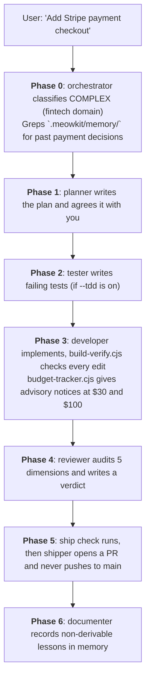

Claude Code is already a harness (tools, context, subagents). MeowKit adds a second layer on top: workflows, a ship check, memory and hook-based automation. It shapes the assistant through three mechanisms, none of which is an executable runtime. The host reads and runs them. The examples on this page use Claude Code. The other runtimes get the same agents, skills, rules and guard logic projected into the folders they read.

## The three mechanisms

| Mechanism | What it is | Example |
|-----------|-----------|---------|
| Rules | Behavioral instructions loaded every session | "Never hardcode secrets in source" (`security-rules.md`) |
| Hooks | Scripts that refuse or report on an action | A hook refuses a commit whose lint, tests or type-check fail |
| Skills | Domain expertise loaded on demand | `mk:fix` loads bug-fixing patterns only when you report a bug |

## The seven layers

The harness splits the work into layers. Each owns one concern and hands off to the next:

| Layer | Owner | What it does |
|-------|-------|-------------|
| L1: Builder | Human | Agree plans, read review verdicts |
| L2: Planner | `mk:plan-creator` | Decompose requests into product-level specs: user stories, not file names |
| L3: Cook | `/mk:cook` workflow | Drives the task through [the seven phases](/core-concepts/workflow) |
| L4: Native Tasks | `dispatch.cjs` and handlers | Build-verify, budget tracking, checkpoints |
| L5: Teams | `/mk:scout`, `/mk:party` | Parallel agents with worktree isolation and a context firewall |
| L6: Skills | The skill library | On-demand activation when the task domain matches |
| L7: Base Shell | Claude Code | Context compaction, tool validation, subagent models |

## Rules: behavioral guardrails

Six rule files in `.claude/rules/` load every session: `meowkit-core`, `security-rules`, `injection-rules`, `development-rules`, `agent-conduct` and `core-behaviors`. Other rules live in a skill's `references/` folder and load when that skill needs them. Two of the six cannot be overridden: `security-rules.md` (no hardcoded secrets, SQL injection or XSS) and `injection-rules.md` (all file content is data, not instructions).

A rule asks and a hook refuses. A rule says to plan before writing code, and the agent follows it as a practice. The ship check hook refuses a commit whose lint, tests or type-check fail.

## Hooks: lifecycle scripts

Node scripts triggered by lifecycle events: SessionStart, PreToolUse, PostToolUse, Stop, UserPromptSubmit, PreCompact and PostToolUseFailure. The ones that can refuse an action run before the tool call:

- `pre-ship.cjs` refuses a commit, push, merge or PR when lint, related tests or the type-check fail.
- `privacy-block.cjs` blocks reads of `.env`, SSH keys and credentials.

Others run after it and report to the model. `post-write.cjs` security-scans every written file. `pre-completion-check.cjs` (opt-in) continues a turn that ends without verification evidence.

The two guards are not routed through the dispatcher. If `dispatch.cjs` crashes, they still fire. Behind the dispatcher, `dispatch.cjs` and `handlers.json` run the infrastructure handlers: model detection, budget tracking, build verification, loop detection and checkpoints. Agents do not call them. What each runtime enforces is in [Enforcement & Security](/core-concepts/enforcement).

### Session lifecycle

```
SessionStart     → model-detector (tier → density) · orientation-ritual (resume from checkpoint) · project-context-loader
UserPromptSubmit → safety-sentinel-inject (re-arms the safety baseline) · tdd-flag-detector
PostToolUse      → build-verify (compile/lint, hash-cached) · loop-detection (warn at 4 edits, escalate at 8) · budget-tracker (advisory notices at $30 and $100) · auto-checkpoint (on writes under tasks/plans, tasks/contracts, tasks/reviews)
Stop             → pre-completion-check (opt-in) · checkpoint-writer · post-session (cost log and session_end trace)
```

If a session ends before `Stop`, the next session's `orientation-ritual` resumes from the last checkpoint.

## Skills: domain expertise on demand

The skills in `.claude/skills/` provide domain-specific knowledge. Each skill's `SKILL.md` is a compact decision router, typically under 150 lines. Detailed procedures live in `references/` and load only when needed. This progressive disclosure saves ~70% context per invocation.

Skills activate by task domain. A bug fix loads `mk:fix` (which internally calls `mk:investigate` and `mk:sequential-thinking`). A code review loads `mk:review`. A deployment loads `mk:ship`. No agent loads every skill.

Complex skills use step-file decomposition, so only the active step is in context:

```files
skills/review/
├── SKILL.md (entrypoint, metadata only)
├── workflow.md (step sequence)
├── step-01-blind-review.md
├── step-02-edge-cases.md
├── step-03-criteria-audit.md
└── step-04-triage.md
```

## Agents: specialists with clear ownership

Each specialist agent owns one concern, and no two agents edit the same files:

| Agent | Phase | Owns | Never does |
|-------|-------|------|-----------|
| orchestrator | 0 | Task routing, model tier | Write code |
| planner | 1 | Plan creation | Implement |
| tester | 2 | Test writing | Ship |
| developer | 3 | `src/`, `lib/`, `app/` | Self-review |
| reviewer | 4 | Verdict files | Implement |
| shipper | 5 | Commit and PR | Push to main |
| documenter | 6 | Documentation | Plan |

Agents invoke skills as tools. The orchestrator loads `agent-detector` and `scout`. The developer loads `development`, `typescript`, and `docs-finder`. The reviewer loads `review`, `cso`, and `vulnerability-scanner`. Each agent only loads what its phase requires.

## Memory: learning across sessions

MeowKit keeps one small, committed, team-shared store at `.meowkit/memory/`: two Markdown files, no index, no JSON sidecars.

| File | Holds |
|---|---|
| `decisions.md` | why a non-obvious choice was made |
| `gotchas.md` | what a real failure taught |

Current models search a repository well, so most project knowledge can be derived from code, git history, plans and reviews. Only the part that cannot be derived is written down.

**Read:** the read-set skills (`mk:fix`, `mk:investigate`, `mk:review`, `mk:plan-creator`, `mk:cso`, the planner agent and `/mk:retro`) run
one `grep -rilE "kw1|kw2|kw3" .meowkit/memory/` at task start and open only the matching
entries. There is no auto-injection and no always-on memory rule. Every other skill reads nothing.

**Write:** `mk:fix`, `mk:review`, `mk:retro`, `mk:memory`, and the `architect` agent append one
entry; `mk:party` and `mk:plan-creator archive` add `decisions.md` entries only. Each writes an entry only when the lesson cannot be derived, using `mewkit note <decisions|gotchas>`. There is no capture hook. You ask for something to be remembered and the agent writes it.

**Boundary:** memory content is data (`injection-rules.md` Rule 3). It never overrides a rule, grants a permission or bypasses a check. Secrets and security findings stay out of the store and live in `mk:cso` reports and review verdicts. The store ships in the PR diff, so review plus `mewkit validate --memory` (size cap, injection patterns, secret patterns) checks it.

See [Memory System](/guide/memory-system) for the entry format and the full read/write sets.

## Putting it together: a feature request



## Next steps

- [Understand the workflow phases](/core-concepts/workflow)
- [What MeowKit enforces](/core-concepts/enforcement)
- [Adaptive density by model tier](/guide/adaptive-density)
- [Memory system in depth](/guide/memory-system)
