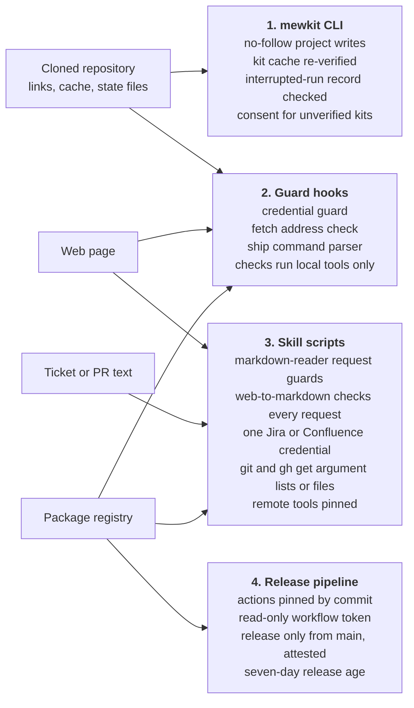
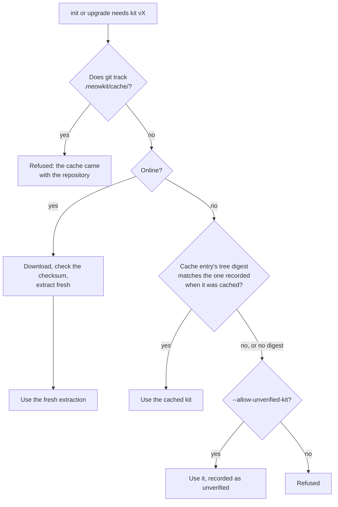
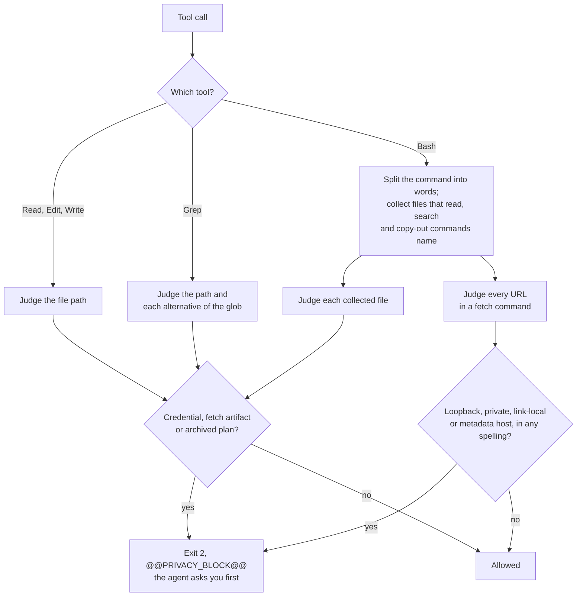

MeowKit runs on a developer's machine, often over content the developer did not write: a cloned repository, a web page, a Jira ticket, a pull request, a package from a registry. The 3.1.0 pre-release audit traced what each of those could make the CLI, a hook or a skill do, and added a defence at each place. This page names those places and the files that hold them.

The [Enforcement & Security](/core-concepts/enforcement) page covers the rules the agent follows, which hook runs on which runtime, and what a guard cannot see. The [3.1.0 changelog](/changelog) lists each fix with the attack it closed.

## The four places



## 1. The mewkit CLI

The CLI writes into the project it runs in. A cloned repository controls every file under its root, symlinks included, so each place where the CLI trusts a project file now checks it first.

| Defence | What it stops | File |
| --- | --- | --- |
| No-follow writes | A symlink committed at, say, `.meowkit/memory/gotchas.md` turning a project write into a write to a shell startup file or `~/.claude/settings.json`. Every write, append, directory creation and read-before-merge of a project path refuses a target that is a symlink or sits under a symlinked folder, and names it | `crates/mewkit-core/src/fsx_no_follow.rs` |
| Kit cache re-verified | A kit planted in `.meowkit/cache/` being installed as if it were the verified release. A cache git tracks is refused. Online, a cache hit is compared with a fresh extraction of the verified archive; offline, with the tree digest recorded when it was cached | `crates/mewkit-core/src/kit/cache.rs`, `crates/mewkit-core/src/kit/tree_digest.rs` |
| Interrupted-run record checked | A forged `.meowkit/state/mewkit-interrupted.json` making `init` copy a file in from outside the project or delete project files. A record is ignored, with a notice, when it is a symlink, its backup is not a `mewkit` backup, or it lists a path the install never writes | `crates/mewkit-core/src/exec/interrupted.rs` |
| Consent for unverified kits | `--kit-dir` installs an unverified local directory, hooks included, so it needs `--allow-unverified-kit`; with `--global` it is refused when `--yes` is given or no terminal is attached. A kit older than the installed one needs `--force`, because an older kit carries older guards | `crates/mewkit-cli/src/kit_args.rs` |

The steps a cached kit goes through before it is used:



An entry cached by an older binary has no tree digest, so the first `--offline` run after upgrading reports it as unverified. One online `init` or `upgrade` fixes that.

## 2. The guard hooks

The guards run before a tool call and block it with exit code 2. Their shared logic sits in `.claude/hooks/lib/` and is copied into every runtime's hook folder (`.codex/hooks/`, `.cursor/hooks/`, `.grok/meowkit/hooks/`, `.agents/meowkit/hooks/`, `.agents/meowkit-antigravity/hooks/`), so one fix reaches each runtime that runs the guard. Which runtimes run which guard is in [What each runtime enforces](/core-concepts/enforcement#what-each-runtime-enforces).

### The credential guard

`privacy-block.cjs` is the entry point. It installs its crash handlers before it loads any library, so a broken library blocks the call instead of letting it through. The decision is split across three files:

| File | Holds |
| --- | --- |
| `.claude/hooks/lib/core/privacy-paths.cjs` | Which paths are credentials: dotenv and direnv files, private keys (a `.pub` file is not one), keystores, `.netrc`, `.pypirc`, `.htpasswd`, registry tokens, Docker, `gh`, gcloud, Azure and kube config, Terraform state and variables, service-account keys, and the `.ssh`, `.aws` and `.gnupg` folders. Names match on path segments, so `kubeconfig.ts` is not a credential. A path that exists is also judged by the file it resolves to, so a harmless-looking link to `.env` is refused like `.env`. `.env.example` is exempt |
| `.claude/hooks/lib/core/privacy-shell-reads.cjs` | Which files a shell command reads, from its own words: the arguments of read and search commands (`cat`, `grep`, `rg`, `sed`, `jq`, `base64` and others), of copy-out commands (`cp`, `scp`, `curl`, `tar`, `source`, `openssl` and others) and of an input redirect. It sees through `sudo`, `env`, `nice`, `time`, `exec` and `nohup`, and skips heredoc bodies, search patterns and option values |
| `.claude/hooks/lib/core/privacy.cjs` | The decision itself: the credential check, the fetch address check, fetch artifacts (the fetch history and quarantined files) and archived plans |



The shell reading is best effort, and the code says so: a path built from a variable or a glob, a command inside `bash -c`, `eval` or a script, and a file a directory-wide `grep -r` happens to reach are not seen. The host's permission system is the control for those.

### The fetch address check

In `privacy.cjs`, when a shell command runs the kit's fetch tool (`mk:web-to-markdown` or its `fetch_as_markdown.py`), every URL in the command is judged, so a safe URL written first cannot cover an unsafe one after it. A host is refused when it is `localhost` or a `.localhost` name, a cloud metadata name, an IPv4 loopback, unspecified, private (`10/8`, `172.16/12`, `192.168/16`), carrier-grade NAT or link-local address, or an IPv6 loopback, unspecified, unique-local, link-local or IPv4-mapped address. Decimal and hex IPv4 spellings are turned into dotted form before the check. `file:`, `chrome:`, `about:`, `data:` and `javascript:` URLs are refused too. This is a second check: the fetch tool validates URLs itself.

### The ship command parser

`.claude/hooks/lib/ship-command.cjs` decides whether a shell command commits, pushes, merges or opens a PR, so the ship check cannot be skipped by rewording the command. It splits the command at `;`, `&&`, `||`, `|`, `&`, parentheses and newlines, then drops shell keywords (`if`, `then`, `{`, `!`), variable assignments, and the wrappers `env`, `command`, `exec`, `sudo`, `nohup`, `time`, `nice` and `xargs` with their options. It skips git's global options and resolves a git alias. A ship run inside `bash -c`, `eval`, `env -S`, backticks or a script file is not seen.

### Checks run only local tools

`build-verify.cjs` and the ship check (`.claude/hooks/lib/preship-checks.cjs`) run Node tools from the project's own `node_modules/.bin` and never through `npx`. With no terminal attached, `npx` installs a missing package without asking, and `npx tsc` resolves to an npm package named `tsc`, not TypeScript. A tool that is not installed is skipped and reported, for example `SKIP: typescript not installed locally`.

## 3. Skill scripts

Skills fetch pages, call Jira and Confluence, and pass text to `git` and `gh`. Each script that handles outside content checks it at the point of use.

| Skill | Defence | File |
| --- | --- | --- |
| `mk:markdown-reader` | Its local server checks the `Host` header (a DNS-rebinding page cannot read through it), serves only real paths inside the project, never serves dotfiles or credential-like names, and sends a Content-Security-Policy. Front-matter is read as YAML or JSON only, and raw HTML is escaped | `scripts/lib/request-security-guards.cjs`, `scripts/lib/markdown-renderer.cjs` |
| `mk:web-to-markdown` | In browser mode every request a page makes, not only the page itself, goes through the same safe-URL check, WebSockets included; service workers are blocked because their requests bypass that check | `scripts/fetch_as_markdown.py` |
| `mk:jira`, `mk:confluence` | The site URL, email and API token are one credential. If they come from two different env files, the wrapper stops with exit code 78 and names both, so a project file that sets only a site URL cannot borrow your user-wide token | `scripts/jira-as.sh`, `scripts/confluence-as.sh` |
| `mk:worktree` | Git is called with an argument list, so a branch named with `$( )` is a name, not a command | `scripts/lib/worktree-git-helpers.cjs` |
| `mk:review-pr`, `mk:respond-pr`, `mk:story-sizer`, `jira-analyst` | Review and ticket text reaches `gh` and `jira-as` through a file, not inside a double-quoted argument where a backtick would run | the skills' `SKILL.md` and scripts |
| several | Remote tools and Python dependencies are pinned to exact versions, and two misnamed `npx` packages were corrected (`@playwright/cli`, `@axe-core/cli`) | the skills' `requirements.txt`, `package.json` and `SKILL.md` |

After upgrading, re-create a skill environment to pick up the pinned versions, for example `mewkit skill env jira`.

## 4. The release pipeline

The binary and the kit reach your machine from this repository's releases. These files decide what a release can contain and who can change it.

| File | Defence |
| --- | --- |
| `.github/workflows/*.yml` | Every action is pinned to a commit hash, and each workflow's token is read-only (`contents: read`); only the release job asks for write access |
| `.github/workflows/rust-release.yml` | Publishes only a tag whose commit is on the default branch, and attests each binary archive before the release is created, so an archive that cannot be attested is never published |
| `scripts/release.sh` | Does not replace an asset of a release that is already published |
| `pnpm-workspace.yaml` | `minimumReleaseAge: 10080`: pnpm installs no package version published less than seven days (10,080 minutes) ago |
| `.github/dependabot.yml` | A seven-day cooldown on GitHub Actions, Cargo and npm updates: Dependabot proposes a new version only after it has been public for a week |
| `SECURITY.md` | How to report a vulnerability privately, what is in scope, and how to verify a download |

To check that a binary archive came from the release workflow:

```bash
gh attestation verify mewkit-<target>.tar.gz --repo ngocsangyem/MeowKit
```

The installers (`install.sh`, `install.ps1`) carry the SHA-256 and size of the archive they install and check both before unpacking.

## What changed for you

- A project file that is a symlink is refused by the commands that write it. Replace the link with a real file if it is yours.
- Keep `MEOW_JIRA_SITE_URL`, `MEOW_JIRA_EMAIL` and `MEOW_JIRA_API_TOKEN` in one env file, and the same for the three Confluence keys.
- A project with a `tsconfig.json` and no local TypeScript gets no type-check at ship time until TypeScript is installed in the project.
- A read refused with `@@PRIVACY_BLOCK@@` is a credential, fetch artifact or archived plan. Approve it when the task needs it; the agent asks first.

## Next steps

- [Enforcement & Security](/core-concepts/enforcement): the rules, and which runtime enforces what
- [Hooks reference](/reference/hooks): every hook and its event
- [Configuration](/reference/configuration): where settings and API keys go
