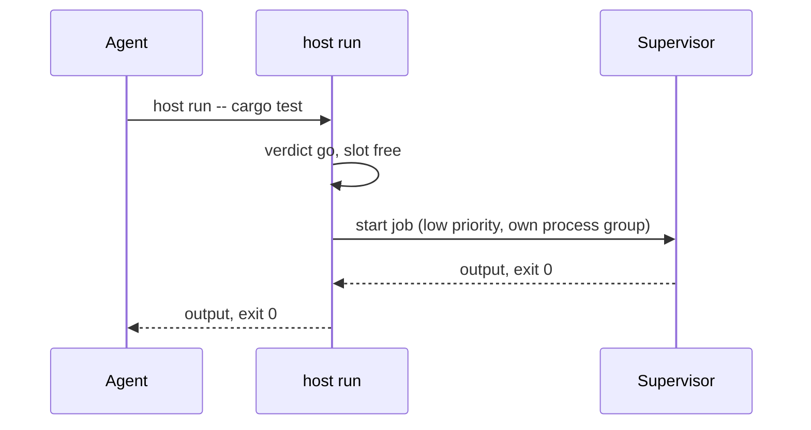
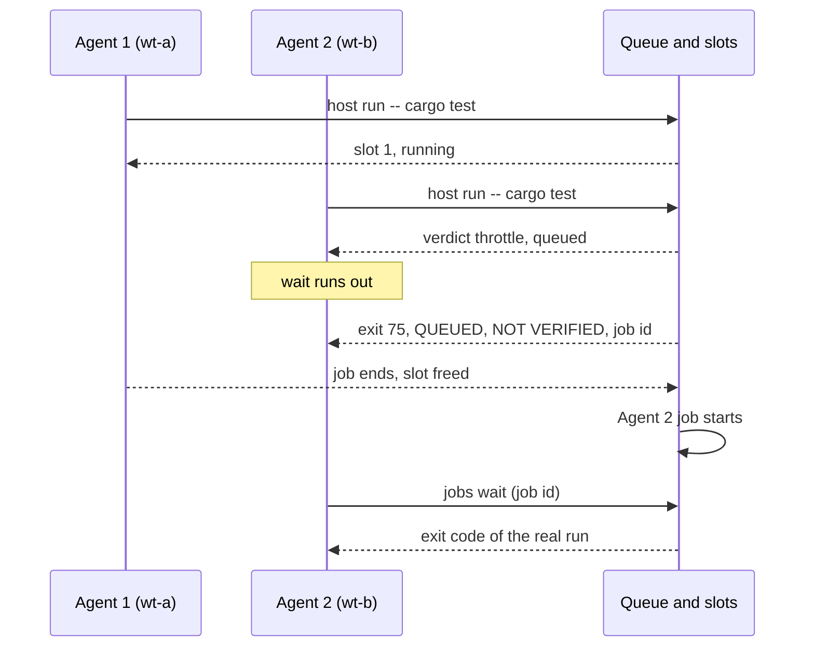
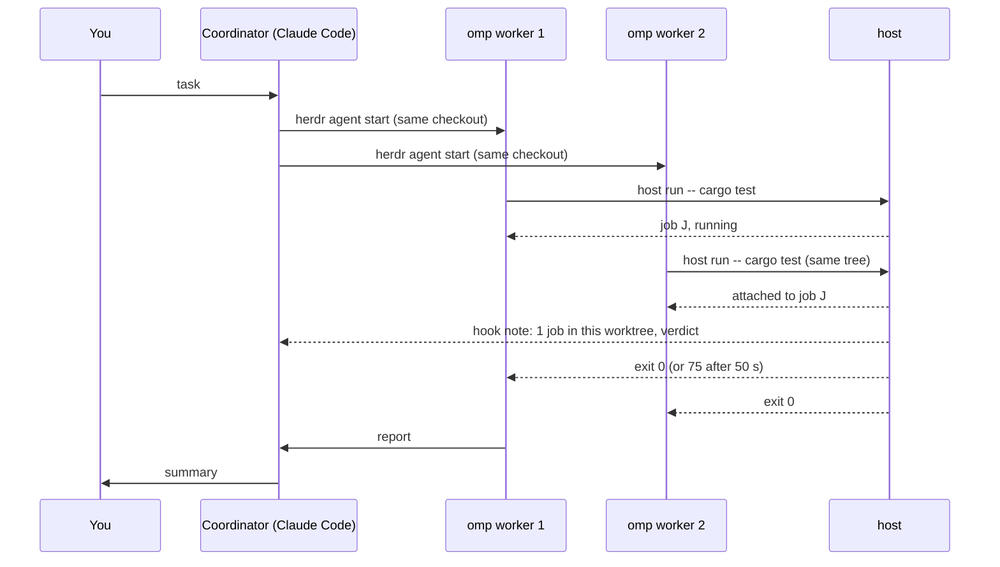
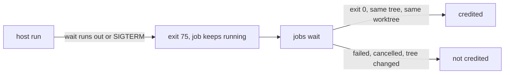
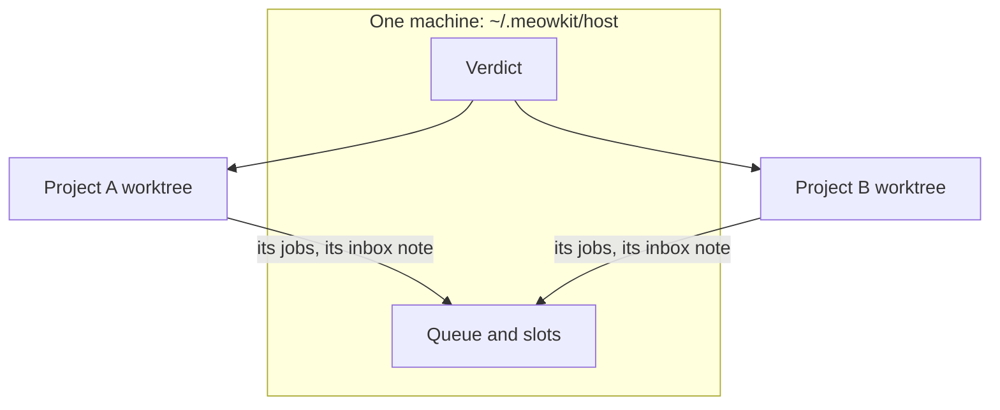
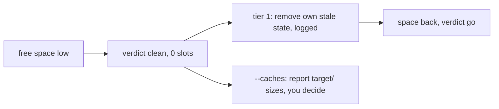

<Callout title="Beta" type="warn">
`mewkit host` is a beta. Its commands, exit codes and settings may change before it is stable.
</Callout>

When several agents share one machine, two full test suites and a release build at once can leave every agent waiting on a tool call it cannot see the end of. `mewkit host` puts heavy commands through one machine-wide queue, returns control within a bounded wait, and tells each agent which worktree and which processes load the host.

## The verdict

`mewkit host status` samples CPU, memory, disk activity, thermal state and free space, and prints one verdict:

| Verdict | Meaning | Heavy jobs admitted at once |
| --- | --- | --- |
| `go` | Room for heavy work | `host.max_heavy` |
| `throttle` | The machine is busy | 1 |
| `unknown` | A sample could not be taken | 1 |
| `clean` | Free space is low | 0 |
| `hold` | The machine is saturated | 0 |

`--json` prints the full sample. `--caches` lists Rust `target/` directories and Cargo cache sizes instead.

## Running a heavy command

```bash
mewkit host run -- cargo test --workspace
```

The command runs without a shell, at low OS priority, in its own process group, under a supervisor that outlives the calling tool call. `run` follows its output until the command ends or the wait runs out.

| Option | Effect |
| --- | --- |
| `--wait 90s` | How long to follow the job. The default sits under the calling agent runtime's tool timeout |
| `--background` | Return at once with the job id |
| `--priority high\|normal\|low` | Queue level. `high` also runs at normal OS priority. A job that waits ages forward one level every 10 minutes |

The same command, with the same arguments, in the same directory of the same worktree, on the same file tree and with the same environment, attaches to the job already running instead of starting a second one. Variables that differ per shell or per agent session do not count: `PWD`, `SHLVL`, `TMPDIR`, anything starting with `CLAUDE`, `CODEX`, `CURSOR`, `GEMINI` or `HERDR_` (herdr gives each pane its own id), and any name containing `SESSION`, `TOKEN`, `_PID` or `SOCK` (omp's `OMP_BASH_SESSION`, for example). Any other variable, `GOOS` or a feature flag for example, makes it another command. Several callers that start the same command at once share one job.

The job's log keeps at most 2 MB. Output is stored line by line through the same secret scrubber that `jobs log` uses, so the file on disk holds no token or address that the scrubber would mask.

When the command exits but a process it started keeps its output open, the job waits up to 10 seconds for that output, then stops what is left and frees its slot. A cancel during that time still ends the job as cancelled (exit 70).

### Several projects on one machine

The queue, the slots, the watcher and `~/.meowkit/host` are shared by every project on the machine, because the load is the machine's. Each job records the worktree it was started from, and the commands keep to it:

- `mewkit host jobs list` shows this worktree's jobs; `--all` shows every worktree's, with the full path.
- `jobs wait <id>` and `jobs log <id>` on another worktree's job say so on stderr. `jobs cancel <id>` refuses another worktree's job unless you pass `--any-worktree`.
- A command never attaches to another worktree's job, and the completion check never credits one.
- Each worktree has its own inbox note; only the verdict (`go`, `hold`, ...) is machine-wide.

`jobs wait <id>` waits for a job, `jobs log <id>` prints its output and `jobs cancel <id>` stops it and everything it started.

### Exit codes

| Code | Meaning |
| --- | --- |
| The command's own | The command finished; its exit code is passed through |
| `75` | Not finished. The first line says `QUEUED — NOT STARTED — NOT VERIFIED` or `STILL RUNNING — NOT VERIFIED`, followed by the job id |
| `70` | The job was cancelled, or its supervisor died. Not verified; run it again once |

A command that itself exits 75 or 70 shows its own output instead of those lines, so read the first line, not the code alone. Exit 75 is never a pass. Wait for the job with `mewkit host jobs wait <id>` and read its exit code. The opt-in completion check (Claude Code, Codex, Cursor and OMP; Pi unverified) credits a `jobs wait` only when the job ended with 0, was not cancelled, and ran in this worktree on the same file tree as the one being checked: the tree is recorded when the command starts and again when it exits, and a job whose tree changed in between, or whose tree is not the current one, earns no credit. The `mk` alias counts like `mewkit`.

If the agent runtime ends the call with SIGTERM or SIGHUP while `run` or `jobs wait` is waiting, it prints the exit-75 block and exits 75; the job keeps running. Ctrl-C at a terminal cancels the job and exits 70 once it has stopped. On Windows these signals keep their default behaviour for now.

When admission is switched off, `HOME` is unset, or anything in the queue fails, `run` runs the command directly in the foreground: an internal error never blocks a command.

## Use cases

Each diagram shows what the host does in one common setup. The host never changes what a command does; it decides when the command starts, how long the caller waits, and who may reuse or credit the result.

### One agent, one heavy command

With a free slot the command starts at once, and its own exit code comes back as if it ran directly.



### Several agents in their own worktrees

Each worktree gets its own job. Slots cap how many heavy jobs run together (`host.max_heavy` under `go`, 1 under `throttle`); the rest wait in the queue. A caller whose wait runs out gets exit 75 and a job id, not a pass.



### A chief-of-staff agent and omp workers in herdr

A Claude Code agent talks to you and never edits; it starts omp workers in herdr panes and reads their reports. By default herdr starts a worker in a sibling pane in the same checkout, so workers and the coordinator share one worktree.

- Two workers running the same command on the same tree share one job: herdr's per-pane `HERDR_*` variables and omp's `OMP_BASH_SESSION` do not make it another command.
- An omp worker waits 50 seconds by default, under omp's 300-second bash timeout, so the tool call returns with output or with exit 75 before omp cuts it off.
- The coordinator's `host-pressure` hook names the worktree's jobs and the machine verdict in its context, so it knows the workers are waiting on the queue, not stuck. It can follow a worker's job with `jobs wait` and `jobs log`.
- omp runs the opt-in completion check: a worker that ends its turn with an unverified edit gets one follow-up, and a passing `host run` or `jobs wait` counts as its check. omp runs no `host-pressure` hook; its skills tell the worker to read `mewkit host status`, and to treat exit 75 as not verified.
- Workers on a herdr worktree (`herdr worktree create`) are another worktree: they get their own jobs, and the coordinator sees them with `mewkit host jobs list` and `--all`.



### A long suite that outlives the tool call

The job keeps running when the runtime ends the call. The completion check credits the later `jobs wait` only for exit 0, on the tree the job ran on.



### Several projects on one machine

The load is the machine's, so the queue and slots are shared; jobs, attach, credit and inbox notes stay with their worktree.



### Low free space

On a `clean` verdict no heavy job is admitted. The watcher removes MeowKit's own stale state and only reports `target/` folders and Cargo caches.



## The watcher

`mewkit host watch --detach` starts one watcher per machine. It samples every 5 seconds and writes, for each worktree that loads the host, a short note naming the heavy processes (by pid and executable name), queue positions and the slots held. It exits after 30 minutes with no agent runtime running. `mewkit host watch --stop` stops it; on Claude Code the hook starts it again on a prompt more than a minute later. To keep it off, set `host.enabled: false`.

On Claude Code the `host-pressure` hook reads that note and adds one line to the agent's context when the verdict is `throttle` or worse, or when this worktree has jobs. It repeats a line at most every 5 minutes unless the verdict gets worse. The hook starts the watcher only from a `mewkit` installed on `PATH`, never from a build inside a git checkout. A git repository whose root is your home directory (dotfiles) does not count as a checkout. On Windows only `mewkit.exe` is started, not a `.cmd` shim. `hooks.host-pressure: false` in `.meowkit/config.yaml` switches it off. Other runtimes do not run the hook; their skills tell the agent to run `mewkit host status`.

## Cleanup

| Tier | What | When |
| --- | --- | --- |
| 1 | MeowKit's own state under `~/.meowkit/host`: ended jobs older than 24 hours, dead queue tickets, stale inbox notes, orphaned temp files, rotated logs | The watcher on a `clean` verdict, at most every 30 minutes; or `mewkit host clean` |
| 3 | Rust `target/` directories | Reported only: `mewkit host status --caches` names them and you decide |

Tier 1 never follows a symlink, never deletes a file another user owns (each file and folder inside an item is checked), and logs each removal to `~/.meowkit/host/clean.log`. `mewkit host clean --dry-run` lists what it would remove.

Some bookkeeping always expires, whatever `host.auto_clean` says, through the same tier 1 rules and logged: ended jobs older than 7 days or beyond the newest 200, command key locks unused for a day, and inbox notes older than 10 minutes. `host.auto_clean` switches off only the tier 1 run on low free space.

On Windows a file's owner cannot be checked yet, so cleanup removes files only when `~/.meowkit/host` lies inside your user profile (`USERPROFILE`), which by default only you and administrators can write. Elsewhere `host clean`, the expiry and the automatic run list items and remove none.

Cargo can clean its own caches: since Rust 1.88 it removes old downloaded crates by itself unless `cache.auto-clean-frequency` is `"never"`. `--caches` says so when that setting turns it off.

## Upgrade and uninstall

The kit files of this feature (the skill references and the hook) are installed, upgraded and removed with the kit like any other file.

The watcher and `~/.meowkit/host` belong to the machine, not to one project:

- After `mewkit self-update` or a package upgrade replaces the binary, the running watcher exits within one sample, and the hook starts the new one. Host state written by a newer release is left alone by an older binary: its watcher exits and its `run` runs the command directly. `mewkit host watch --detach` also replaces a watcher from another version at once.
- When `mewkit uninstall --yes` removes the last runtime of an install, it stops the watcher and names `~/.meowkit/host`. The folder stays, because other projects on the machine may use it: `mewkit host clean` removes its stale parts, and you can delete it when no project uses MeowKit any more.
- `mewkit doctor` has a `host watcher (beta)` row: running or not, its version, and the size of the state.

## Settings

The settings are machine-wide, because the queue and the watcher serve every project on the machine. They live in `~/.meowkit/config.yaml` only; a project's `.meowkit/config.yaml` that sets them is refused.

```yaml
# ~/.meowkit/config.yaml
host:
  enabled: true      # false: run runs commands directly, unqueued
  auto_clean: true   # false: no tier 1 run on low free space; 7-day job expiry still runs
  max_heavy: 2       # heavy jobs at once under `go`; 1-8, default a quarter of the cores (1-4)
```

## Platforms

macOS, Linux and Windows. Low priority is `taskpolicy -d throttle` (disk I/O) on macOS, `nice -n 10` and `ionice -c3` on Linux, and below-normal priority on Windows.
