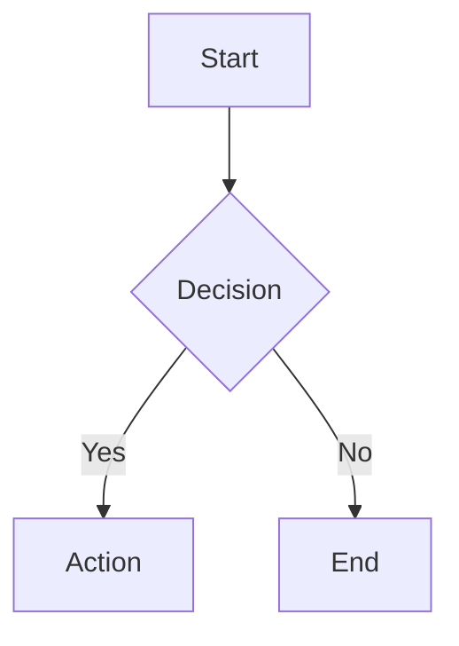

{/* GENERATED:reference-facts START */}

| | |
|---|---|
| **Source** | [`.claude/skills/mermaidjs-v11/SKILL.md`](https://github.com/ngocsangyem/MeowKit/blob/main/.claude/skills/mermaidjs-v11/SKILL.md) |
| **Owner** | `utility` |
| **Runtime** | `claude-code` |
| **Risk** | medium |
| **Phase** | `on-demand` |

{/* GENERATED:reference-facts END */}

## What it does

Writes Mermaid v11 diagrams as fenced code blocks that render in GitHub, GitLab, a markdown viewer or a browser with the Mermaid script. Use it when a diagram belongs in a README or a markdown document. It needs no dependencies at render time. `mmdc` (the Mermaid CLI) is optional for exporting files.

## When not to use

For a standalone SVG or PNG, or a diagram to publish, use `mk:tech-graph`. For an HTML page, explainer or slide deck use `mk:preview`.

## Usage

Ask for a diagram in words, for example "draw a flowchart of the auth flow" or "add a sequence diagram of this API call". The skill answers with a code fence ready to paste.

````markdown

````

| Type | Use |
|---|---|
| `flowchart` | Process flows, decisions |
| `sequenceDiagram` | Actor and API interactions |
| `classDiagram` | Object and data models |
| `stateDiagram` | State machines |
| `erDiagram` | Database relationships |
| `gantt` | Timelines |
| `journey` | User journeys |

The full v11 syntax catalog is `references/diagram-types.md`. Other references: `configuration.md` (theme, look, font, security level), `cli-usage.md` (Docker, batch export), `integration.md` (HTML embedding, Node API) and `examples.md` (patterns).

Per-diagram settings go in a frontmatter block inside the fence, such as `theme: dark`. Comments start with `%%`.

## Export with mmdc

```bash
npm install -g @mermaid-js/mermaid-cli
mmdc -i diagram.mmd -o diagram.svg
mmdc -i input.mmd -o output.png -t dark -b transparent
```

`mmdc` needs Node 18 or newer.

## Gotchas

| Trap | Detail |
|---|---|
| v10 aliases | v11 removed some. Use `flowchart`, not `graph`. |
| Strict security level | `securityLevel: "strict"` strips HTML from labels, so use plain text. |
| Frontmatter | The `---` config block in a fence needs Mermaid 10.7 or newer. Older renderers print it as content. |
| `@import` in `<style>` | It breaks `rsvg-convert`. Embed fonts inline if you later export with `mk:tech-graph`. |
