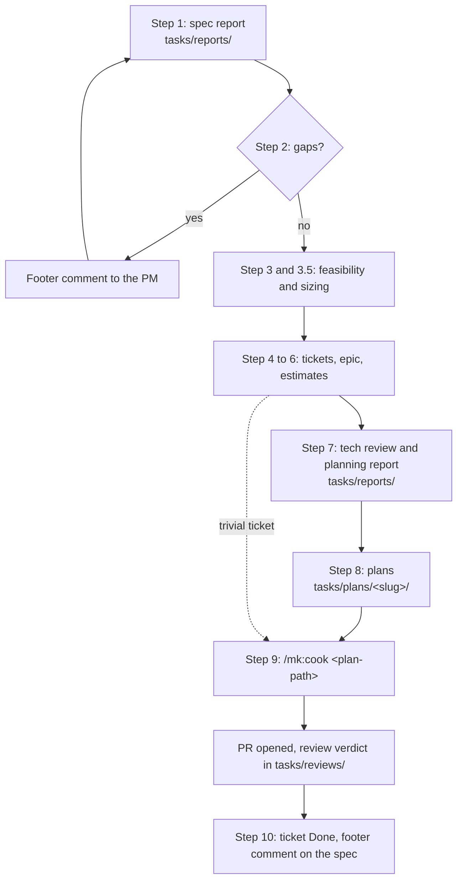
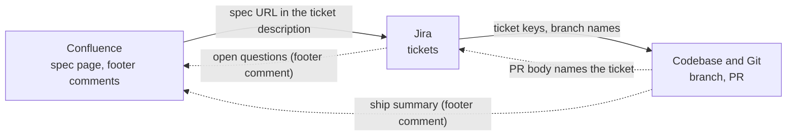

This walkthrough follows one spec through Confluence, Jira and your codebase. Each step page shows the prompt you type, the skills that run, the artifact written and the decision that is yours. It is written for developers who want to know why the workflow has this shape and not only which commands to run.

A first read takes about 20 minutes. A real run takes one to four hours, depending on ticket size. For the commands only, [Ticket to Code](/workflows/ticket-to-code) covers the second half.

## Before you start

Jira access needs the `jira-as` CLI and three variables in `.meowkit/.env`. [Jira Integration](/guides/jira-integration) covers the install, the token and what to check when authentication fails. Confluence uses the same token and setup. [Confluence Integration](/guides/confluence-integration) covers the Cloud-only limit if you are on Server or Data Center.

## The ten steps

<Cards>
  <Card title="Step 1: Pull the spec out of Confluence" href="/workflows/spec-to-pr-walkthrough/step-01-pull-the-spec" description="mk:confluence-spec-analyst writes a Spec Research Report locally." />
  <Card title="Step 2: Send open questions back to the PM" href="/workflows/spec-to-pr-walkthrough/step-02-open-questions" description="Footer comments carry ambiguities back to Confluence, and the walkthrough pauses." />
  <Card title="Step 3: Tech feasibility breakdown" href="/workflows/spec-to-pr-walkthrough/step-03-tech-feasibility" description="A read-only scan with mk:scout and mk:docs-finder before any ticket exists." />
  <Card title="Step 3.5: Story sizing" href="/workflows/spec-to-pr-walkthrough/step-03-5-story-sizing" description="mk:story-sizer sizes each story. Advisory by default." />
  <Card title="Step 4: Create the Jira tickets" href="/workflows/spec-to-pr-walkthrough/step-04-create-tickets" description="One command per issue, with the spec URL in the description." />
  <Card title="Step 5: Group into an epic and rank" href="/workflows/spec-to-pr-walkthrough/step-05-epic-and-rank" description="Epic, rank and blocking links, all declared by you." />
  <Card title="Step 6: Refine and estimate" href="/workflows/spec-to-pr-walkthrough/step-06-refine-and-estimate" description="The evaluator rates complexity and the estimator suggests points." />
  <Card title="Step 7: Tech review against your codebase" href="/workflows/spec-to-pr-walkthrough/step-07-tech-review" description="mk:planning-engine reviews each ticket and plans the sprint." />
  <Card title="Step 8: Plan per ticket" href="/workflows/spec-to-pr-walkthrough/step-08-plan-per-ticket" description="mk:plan-creator writes a plan per ticket, in a mode that fits its size and risk." />
  <Card title="Step 9: Implement with /mk:cook" href="/workflows/spec-to-pr-walkthrough/step-09-implement-with-cook" description="The cook pipeline from orient to reflect, with the review verdict at Phase 4." />
  <Card title="Step 10: After merge, close the loop" href="/workflows/spec-to-pr-walkthrough/step-10-close-the-loop" description="Transition the ticket and comment back on the spec page." />
</Cards>

The quick path, one command per stage:

```bash
/mk:confluence-spec-analyst analyze 12345 --include-children 1
/mk:jira-issue create --project AUTH --type Story ...   # one per story it found
/mk:planning-engine plan --tickets AUTH-201,AUTH-202 --capacity 40
/mk:cook AUTH-201                                       # then repeat per ticket
/mk:ship
```

## How the steps connect

Every skill writes an artifact, and you read it before the next step. The paths below mark where each one lands.



A trivial ticket skips Steps 7 and 8. You hand cook a task description, and cook writes and agrees the plan in its own Phase 1.

Planning and review are practices in this workflow. You agree each plan and read each review verdict, and no hook blocks an edit or a commit when you skip either. The one enforced control is the [ship check](/core-concepts/enforcement#the-ship-check), which runs at commit, push, merge and PR.

Reports from Steps 1 to 7 stay in `tasks/reports/`, and plans from Step 8 go to `tasks/plans/<slug>/`. Nothing copies one into the other.

## What crosses between systems



Solid arrows carry work forward. Dashed arrows write back to a system you already used.

## Decisions that are yours

| Decision | When |
| --- | --- |
| Which spec gaps to resolve before ticketing | After Step 1 |
| Feasibility, and which stories to defer | After Step 3 |
| Which stories to file, and whether to batch-create | After Step 3.5 |
| Ranking and dependencies | Step 5 |
| Story-point estimate | After Step 6, as a team |
| Plan mode per ticket, and agreeing each plan | Step 8, or cook's Phase 1 for trivial tickets |
| Whether to ship with WARN dimensions | After the Phase 4 verdict |

## When the situation differs

| Situation | What to do |
| --- | --- |
| The spec is already a Jira ticket | Start at Step 6. |
| Tickets exist but nobody analyzed a spec | Start at Step 6 and ask the product owner to fill in acceptance criteria. |
| The work is a bug | Use [Fix a Bug](/guides/fix-a-bug). The spec analyst does not apply. |
| A one-shot hotfix with no blast radius | `/mk:fix` skips the separate plan, as `scale-adaptive-rules.md` Rule 4 describes. |
| A green-field product | Use [Autonomous Build](/guides/autonomous-build) with `/mk:autobuild`. |
| The spec changed mid-sprint | Run `/mk:confluence-spec-analyst` again. The report ends with a page hash, which shows whether the page changed. |
| An estimate was far off | Update the points through `mk:jira-agile` and raise it at the retro. |
| A plan is more than 14 days old | Cook warns about it. Run `mk:plan-creator` again before cooking. |
| The review verdict is FAIL | Fix the failing dimension and run `/mk:review` again before shipping. |

## Related

- [Spec to Sprint Planning](/workflows/spec-to-sprint) covers the planner side of Steps 1 to 7.
- [Ticket to Code](/workflows/ticket-to-code) covers the per-ticket cycle that Step 9 sits inside.
- [Agile / Scrum Workflow](/workflows/agile-scrum) covers the sprint rituals around this loop.
- [Review Code](/guides/review-code) and [Ship Safely](/guides/ship-safely) cover Phases 4 and 5 in depth.
