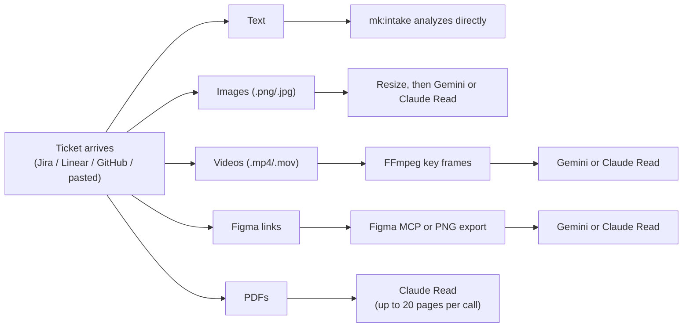

This playbook covers the attachments on a ticket: images, video recordings, Figma links and PDFs. `mk:intake` turns each into text you can reason about, and falls back to a simpler tool when the best one is missing.

**Best for:** Team leads, QA engineers, frontend developers
**Time estimate:** Images about 30 seconds, video 1 to 2 minutes, Figma about 1 minute
**Skills used:** [mk:intake](/reference/skills/intake), [mk:jira-issue](/reference/skills/jira-issue), [mk:jira-collaborate](/reference/skills/jira-collaborate), [mk:figma](/reference/skills/figma), [mk:multimodal](/reference/skills/multimodal), [mk:investigate](/reference/skills/investigate)

## Quick path

```bash
/mk:intake BUG-789          # pulls the ticket and its attachments, describes what it found
/mk:investigate             # uses those findings as evidence
/mk:jira-collaborate add a comment to BUG-789 with the findings
```

You end up with the media described in text and a comment on the ticket that records it. A missing tool lowers the fidelity of the read; it does not stop the analysis, except for video, which needs FFmpeg.

Jira access needs the `jira-as` CLI and three variables in `.meowkit/.env`; see [Jira Integration](/guides/jira-integration). The rest of the intake pipeline is on [PRD Intake](/workflows/prd-intake).

## How each attachment is handled



Optional tools:

| Tool | What it adds | Install |
|---|---|---|
| Figma MCP | Exact design data (colors, spacing, tokens) | `claude mcp add figma` |
| Gemini API key | More precise image and video analysis | Set `MEOWKIT_GEMINI_API_KEY` in `.meowkit/.env` (`GEMINI_API_KEY` also works) |
| FFmpeg | Video frame extraction, image resizing | `brew install ffmpeg` or `mewkit setup --system-deps` |
| ImageMagick | Image resizing | `brew install imagemagick` or `mewkit setup --system-deps` |

## Screenshots

Scenario: BUG-456 has `error-state.png` and `expected-state.png`.

```bash
/mk:intake BUG-456
```

Intake finds the images in the ticket's attachments and works down this chain:

1. If FFmpeg or ImageMagick is installed, resize to 1920 px wide or less (60 to 80 percent fewer tokens).
2. If a Gemini key is set, `mk:multimodal` analyzes the image: layout, components, states and on-screen text.
3. Otherwise Claude's Read tool reads the image. It is weaker on small text, exact colors and spacing.

The result goes into the intake output as a Design Context section: attachments analyzed, UI elements, layout, visible states and gaps.

## Video recordings

Scenario: BUG-789 has `bug-reproduction.mp4`, two minutes long.

Video needs FFmpeg. Intake extracts key frames at scene changes, which cuts a two-minute video from thousands of frames to 10 to 20:

```bash
ffmpeg -i bug-reproduction.mp4 -vf "select='gt(scene,0.3)'" -vsync vfq frame_%03d.jpg
```

Gemini analyzes the frames as a batch; without a key, Claude reads them one at a time. Intake then builds a timeline from the frames (page loaded, credentials entered, submit clicked, spinner, error toast, redirect). `mk:investigate` uses that timeline as evidence for the root cause.

Without FFmpeg, intake reports that it cannot analyze the video, suggests installing it, notes the gap in its output and carries on with the rest of the ticket. A workaround is to screenshot the key moments and attach them as images.

## Figma links

Scenario: PRD-123 contains `https://www.figma.com/design/abc123/MyApp?node-id=2304:512`.

Intake detects `figma.com/design/`, `figma.com/file/` and `figma.com/proto/` links and calls `mk:figma` in Analyze mode.

| Situation | What happens |
|---|---|
| Figma MCP available | `mk:figma` reads the component tree, styles and layout (`get_design_context`) and a screenshot (`get_screenshot`). You get exact values. |
| No MCP, PNG export available | Intake asks you to export the frames as PNG, then reads them as images. Values are approximate. |
| Neither | Intake reports that it cannot read the design and suggests `claude mcp add figma` or a PNG export. |

`/proto/` links are not read for design data. `mk:figma` asks for the `/design/` or `/file/` URL.

To build from the design, run `/mk:cook implement the login screen from PRD-123`. `mk:cook` uses `mk:figma` in Implement mode, a seven-step workflow that ends with a visual parity check.

## PDF specifications

Scenario: a feature ticket has `requirements-v2.pdf`, 15 pages.

Claude's Read tool opens PDFs natively, up to 20 pages per call; larger files are read in page ranges. Intake extracts requirements, acceptance criteria, API contracts and wireframe locations. A `.docx` has to be exported to PDF first. No external tool is needed.

## Post the analysis to the ticket

```bash
/mk:jira-collaborate add the intake analysis as a comment on BUG-789
```

## Fallback summary

| Attachment | Best path | Fallbacks | With no extra tools |
|---|---|---|---|
| Image | FFmpeg resize, then Gemini | Gemini on the raw image, then Claude Read | Claude Read works |
| Video | FFmpeg frames, then Gemini | FFmpeg frames, then Claude Read | Not analyzed; screenshot key moments |
| Figma link | Figma MCP | PNG export read by Gemini or Claude | Cannot read the design |
| PDF | Claude Read | None needed | Claude Read works |
| Text | Direct analysis | None needed | Works |

## Related

- [PRD Intake](/workflows/prd-intake) for the full intake pipeline
- [Fix a Bug](/guides/fix-a-bug) for the investigation that follows
- [Build a Feature](/guides/build-a-feature) for implementing from a design
- [QA Testing](/workflows/qa-testing) for visual verification afterwards
